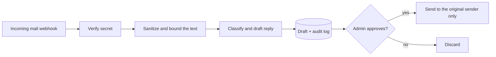

<div align="center">



<br>

An AI agent that reads incoming mail, classifies it and drafts a reply.
**It never sends on its own: a person approves every message.**


</div>

## Why it exists

Mail is where small businesses lose hours, and fully automatic AI replies are risky: one misread message or one prompt-injection attempt and the wrong thing goes out. This agent keeps the speed of AI drafting and puts a hard human gate in front of every send.

## How it works



| Step | What happens |
|---|---|
| 1. Receive | A webhook delivers each new message with a bearer secret, compared in constant time. Requests without the valid secret are rejected. |
| 2. Sanitize | Email text is wrapped as untrusted data and length-bounded before the model sees it. |
| 3. Classify | The model returns a structured result: `ACTION_REQUIRED`, `INFORMATIONAL`, `SPAM_OR_UNSAFE` or `NEEDS_HUMAN_REVIEW`, with a confidence and a rationale. |
| 4. Draft | A plain-text reply proposal is stored. Nothing is sent. |
| 5. Approve | Only the configured admin GitHub login can open the approval screen and approve a draft. |
| 6. Send | The reply goes out through an idempotent send path, so a retry can never double-send. |

## Safety by design

- **Human in the loop.** There is no code path that sends without an approved draft.
- **Recipient policy.** A reply may only go to the original sender. No CC, no BCC, no arbitrary recipients.
- **Prompt-injection defense.** Mail content is delimited as data, and the model is told never to act on instructions inside it. Adversarial cases are covered by tests.
- **Idempotency.** Every webhook event and every send carries a key, so retries are safe.
- **Audit trail.** Each event and each decision is recorded in `mail_audit_events`.
- **Least privilege.** Row-level security on the database, a mailbox-scoped token, and a retention job that removes old data.

## Stack

Next.js (App Router) and TypeScript, Supabase (Postgres with row-level security), Auth.js with GitHub login for the admin screen, the Vercel AI SDK with Gemini for classification, Resend for alerts, Vitest for tests.

## Tests

```bash
npm install
npm test
```

22 test files, 89 tests: unit tests for classification, the recipient policy, sanitizing, idempotency and signature checks, plus integration tests for the webhook route and the send boundary.

## Run it yourself

1. Copy `.env.example` to `.env.local` and fill in your own values.
2. Run the SQL files in `db/migrations/` in order against a Supabase project.
3. `npm run dev`, then follow `docs/runbook.md` to register the mail webhook.

## Author

Built by [Yassine Emhamed](https://www.yassine-emhamed.net), IT and Network Engineer.
